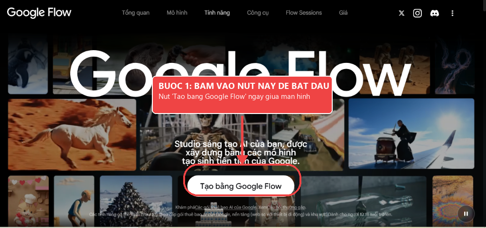
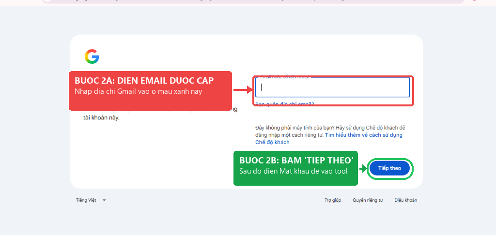
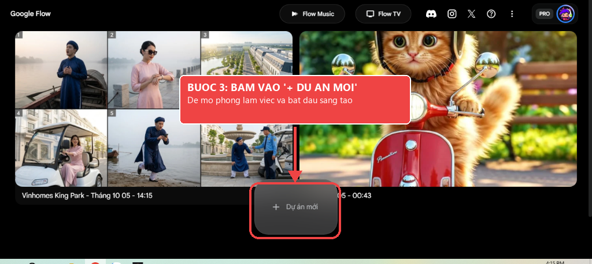
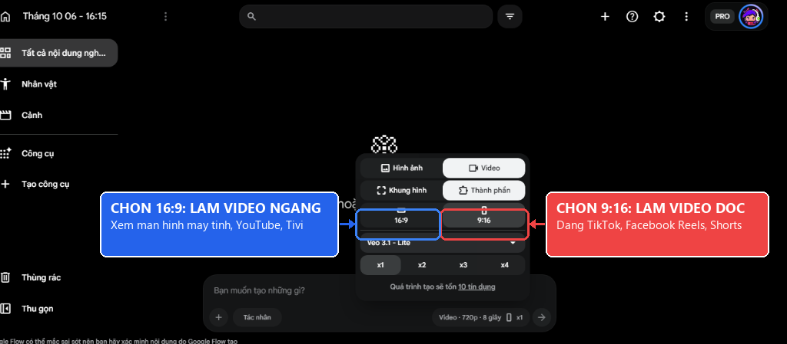
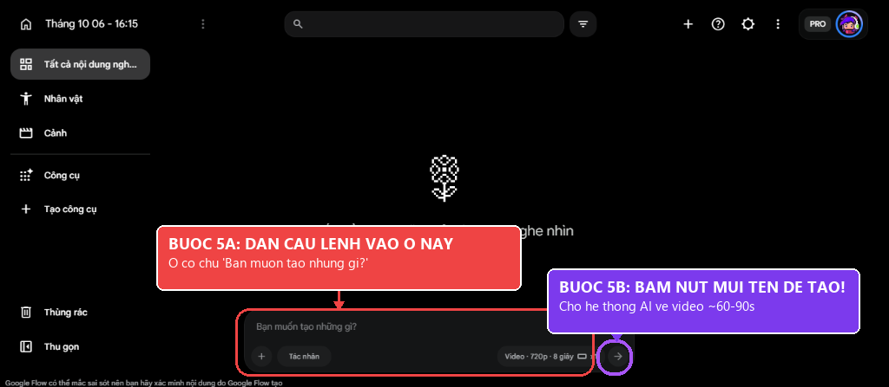
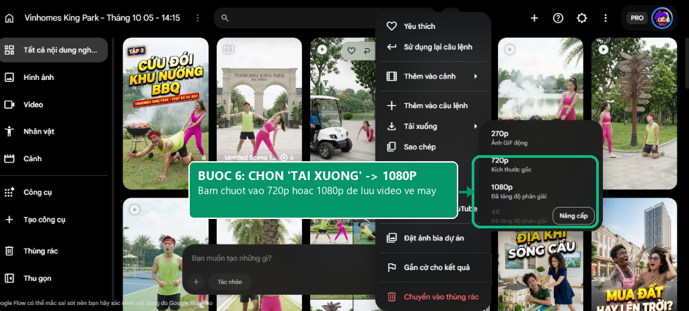

# HƯỚNG DẪN CƠ BẢN TẠO VIDEO AI GOOGLE VEO 3 & FLOW
## (Dành Cho Gói Khởi Đầu 19k & Gói Combo 69k — Cực Kỳ Đơn Giản, Ai Cũng Làm Được!)

> Chào bạn! Bạn không cần biết kỹ thuật máy tính phức tạp, cũng không cần giỏi tiếng Anh. Chỉ cần làm theo đúng **4 bước bấm chuột** dưới đây là sau 1 phút bạn sẽ có ngay một thước phim AI tuyệt đẹp đầu tiên!

---

## 🚀 QUY TRÌNH 6 BƯỚC "CẦM TAY CHỈ VIỆC" (ẢNH CHỤP THẬT TỪ GOOGLE FLOW)

### BƯỚC 1: Mở trang web & Bấm "Tạo bằng Google Flow"
1. Mở trình duyệt Google Chrome và truy cập vào:  
   👉 **[https://labs.google/fx/tools/flow](https://labs.google/fx/tools/flow)**
2. Nhìn vào giữa màn hình, bấm vào nút màu trắng tròn to có chữ:  
   👉 **`Tạo bằng Google Flow`**.



---

### BƯỚC 2: Đăng nhập tài khoản Google được cấp
1. Nhập **Email** (Gmail) được gửi cho bạn khi mua gói vào ô màu xanh.  
2. Bấm nút màu xanh **`Tiếp theo`** ➔ Điền **Mật khẩu** để đăng nhập.


*(Mẹo: Bấm "Lưu mật khẩu" trên Chrome để những lần sau vào là dùng được ngay!)*

---

### BƯỚC 3: Bấm vào nút "+ Dự án mới"
Sau khi đăng nhập, tại trang quản lý video:  
👉 Nhìn vào chính giữa màn hình, nhấp chuột vào nút màu xám bo tròn: **`+ Dự án mới`** để mở phòng làm video.



---

### BƯỚC 4: Cài đặt Khung hình (Dọc 9:16 hoặc Ngang 16:9)
Nhìn xuống thanh công cụ dưới đáy màn hình, bấm vào nút thông số `Video · 720p · 8 giây`:
* 📱 **Nút 9:16 (Khung Dọc màu đỏ):** Bấm chọn nếu đăng lên **TikTok, Facebook Reels, YouTube Shorts**.
* 💻 **Nút 16:9 (Khung Ngang màu xanh):** Bấm chọn nếu xem trên **YouTube dài, Màn hình máy tính, Tivi**.
* ⚡ **Mục Model:** Giữ nguyên mặc định **Veo 3.1 - Lite** (hoặc Veo 3) để tạo video nhanh nhất.



---

### BƯỚC 5: Dán câu lệnh & Bấm nút mũi tên tạo video
1. Kéo xuống **Mục 4** ở dưới, chọn 1 câu lệnh mẫu bạn thích và bấm **Sao chép**.
2. Nhấp chuột vào ô màu đen ở đáy màn hình có dòng chữ: **`Bạn muốn tạo những gì?`** rồi dán câu lệnh vào (`Ctrl + V`).
3. Bấm vào **CÁI NÚT TRÒN CÓ MŨI TÊN ➔** ở góc phải thanh nhập để bắt đầu tạo video!
4. Giữ nguyên màn hình khoảng 60–90 giây để máy tính tự vẽ từng khung hình. Tuyệt đối không bấm F5 tải lại trang nhé!



---

### BƯỚC 6: Xem video thành phẩm & Tải về máy 1080p
1. Khi máy tính chạy xong 100%, video sẽ tự động phát mượt mà ngay trước mắt bạn.
2. Di chuột vào video (hoặc nhấp vào menu 3 chấm) ➔ Chọn mục **`Tải xuống`**.
3. Chọn độ phân giải **`1080p`** (hoặc `720p`) để tải file video mp4 sắc nét về máy tính hoặc điện thoại!



---

## 🍔 MẸO TỰ NGHĨ CÂU LỆNH (CÔNG THỨC CHIẾC BÁNH MÌ KẸP 3 TẦNG)

Nếu sau này bạn muốn tự tạo video theo ý riêng của mình, chỉ cần nhớ công thức 3 tầng này:

* **Tầng 1 (Cái gì/Con gì?):** Bạn muốn video có ai?  
  *(Ví dụ: Một chú mèo con lông xù màu cam, hoặc Một chai nước hoa, hoặc Chiếc xe ô tô thể thao).*
* **Tầng 2 (Đang làm gì, ở đâu?):**  
  *(Ví dụ: Đang đi dạo trong công viên đầy nắng vàng, hoặc Đang đứng trên mặt đá cẩm thạch).*
* **Tầng 3 (Dán câu thần chú làm đẹp):** Luôn dán thêm cụm từ này vào cuối câu lệnh:  
  `cinematic, 4k 60fps, ultra realistic, beautiful lighting`  
  *(Câu này để ra lệnh cho AI phải vẽ nét căng, chuyển động mượt mà, không bị mờ).*

> 💡 **Mẹo lười:** Bạn chỉ cần gõ tiếng Việt Tầng 1 và Tầng 2 vào [Google Dịch](https://translate.google.com), dịch sang tiếng Anh, rồi dán thêm câu thần chú Tầng 3 vào đuôi là xong!

---

## 🎬 3 CÂU LỆNH MẪU "MÌ ĂN LIỀN" (BẤM COPY LÀ CÓ VIDEO ĐẸP NGAY)

### Mẫu 1: Chú Mèo Con Dễ Thương Lái Xe (Dễ thương triệu view TikTok)
> *Mô tả: Một chú mèo con đội mũ bảo hiểm tí hon đang ngồi lái xe tay ga mini trên phố nắng đẹp.*
```text
A cute fluffy ginger kitten wearing a tiny vintage motorcycle helmet, riding a small pastel scooter through a sunny park path, funny and adorable facial expression, slow motion, shallow depth of field, bright warm sunlight, Pixar cinematic animation style, 4k 60fps.
```

### Mẫu 2: Review Chai Nước Hoa Thủy Tinh (Bán hàng mỹ phẩm cao cấp)
> *Mô tả: Chai nước hoa thủy tinh sang trọng đứng trên đá cẩm thạch đen ướt, máy quay lượn vòng 90 độ êm ái.*
```text
Close-up shot of a luxury frosted glass perfume bottle standing on a polished black marble surface, micro water droplets on glass, soft volumetric studio rim lighting. Camera slowly orbits 90 degrees around the bottle, shallow depth of field, commercial grade, 4k 60fps, ultra realistic photorealistic.
```

### Mẫu 3: Flycam Phong Cảnh Du Lịch Sa Pa (Hùng vĩ chuẩn VTV)
> *Mô tả: Flycam bay lướt qua ruộng bậc thang Sa Pa lúc sáng sớm, có biển mây bồng bềnh và ánh nắng sớm.*
```text
Breathtaking aerial drone flight over golden terraced rice fields in Sapa Vietnam at sunrise, gentle mist floating between mountain valleys. Camera glides smoothly forward and slowly tilts up to reveal the vast sky, warm cinematic golden sunlight rays, National Geographic cinematography, ultra high definition 8k, vibrant natural colors.
```

---

## ❓ 3 CÂU HỎI THƯỜNG GẶP NHẤT

**1. Sao tôi bấm nút màu tím mà video chưa ra ngay?**  
👉 Máy tính AI cần từ 60 đến 90 giây để vẽ hàng trăm bức ảnh ghép lại thành video chất lượng cao cho bạn. Bạn chỉ cần đợi thanh phần trăm chạy đến 100% nhé! Tuyệt đối không bấm F5 tải lại trang.

**2. Tôi muốn video dài hơn thì làm thế nào?**  
👉 Khi video tạo xong, bạn nhìn lên góc trên bên phải video sẽ có nút **`[+] Extend (+5s)`**. Bạn bấm vào đó thì AI sẽ vẽ tiếp thêm 5 giây nối tiếp câu chuyện liền mạch!

**3. Nếu tôi không đăng nhập được hoặc quên mật khẩu thì hỏi ai?**  
👉 Đừng ngại! Toàn bộ tài khoản bán ra đều được **bảo hành 1 đổi 1 trong vòng 24 giờ**. Bạn chỉ cần nhắn tin trực tiếp qua **Zalo hỗ trợ kỹ thuật: 0347.999.726**, đội ngũ hỗ trợ sẽ cấp lại tài khoản ngay cho bạn!

---

## 💾 CÁCH LƯU HOẶC GỬI HƯỚNG DẪN NÀY CHO KHÁCH HÀNG:
1. **Gửi file PDF đẹp mắt:** Mở file [huong-dan-co-ban.html](file:///e:/ui-ux-pro-max-skill/preview/huong-dan-co-ban.html) bằng Google Chrome -> Bấm nút **"In / Lưu PDF"** ở góc trên cùng (hoặc bấm `Ctrl + P`) -> Chọn "Lưu dưới dạng PDF" -> Bấm Lưu.
2. **Gửi qua tin nhắn Zalo:** Copy trực tiếp 6 bước ở trên dán vào tin nhắn Zalo kèm 6 file ảnh minh họa chụp thật trong thư mục `assets/` (`guide_step1_home.png` đến `guide_step6_download.png`).
