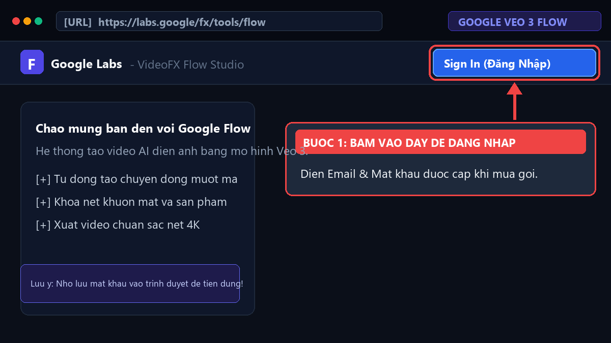
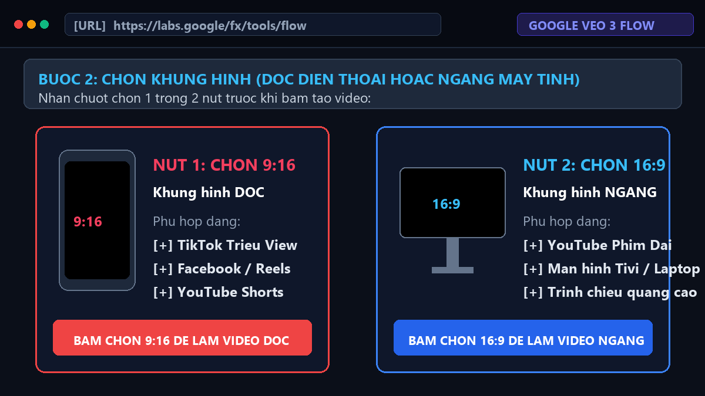
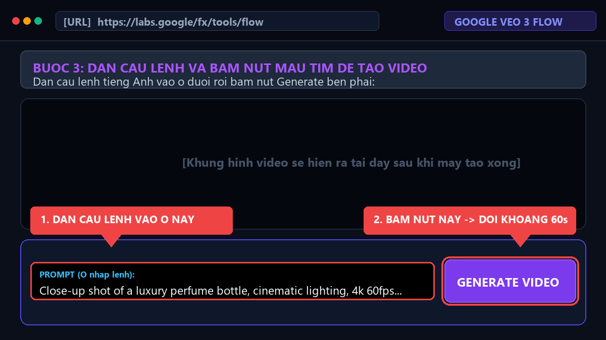
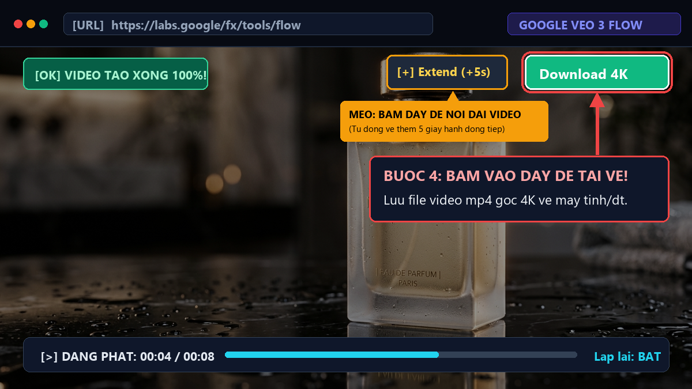

# HƯỚNG DẪN TẠO VIDEO AI GOOGLE VEO 3
## (Cực Kỳ Đơn Giản — Dành Cho Người Mới Bắt Đầu, Bé Lớp 5 Cũng Tự Làm Được!)

> Chào bạn! Bạn không cần biết kỹ thuật máy tính phức tạp, cũng không cần giỏi tiếng Anh. Chỉ cần làm theo đúng **4 bước bấm chuột** dưới đây là sau 1 phút bạn sẽ có ngay một thước phim AI tuyệt đẹp!

---

## 🚀 QUY TRÌNH 4 BƯỚC "CẦM TAY CHỈ VIỆC"

### BƯỚC 1: Mở trang web và Đăng nhập (Mất 30 giây)
1. Bấm mở đường link này trên trình duyệt Google Chrome:  
   👉 **[https://labs.google/fx/tools/flow](https://labs.google/fx/tools/flow)**
2. Nhìn lên góc **trên cùng bên phải**, bạn sẽ thấy nút màu xanh có chữ:  
   👉 **`Sign In`** *(nghĩa là: Đăng nhập)*.
3. Bấm vào đó rồi điền **Tài khoản (Email)** và **Mật khẩu** mà bạn vừa nhận được khi mua gói.


*(Thế là xong Bước 1, bạn đã vào được phòng làm phim AI!)*

---

### BƯỚC 2: Chọn video DỌC hay video NGANG (Mất 5 giây)
Nhìn vào phía dưới màn hình, bạn sẽ thấy 2 lựa chọn khung hình:

* 📱 **Nếu bạn muốn đăng lên TikTok, Facebook Reels, YouTube Shorts:**  
  👉 Bấm chọn nút **`9:16`** *(Khung hình DỌC như màn hình điện thoại)*.
* 💻 **Nếu bạn muốn đăng lên YouTube dài, Tivi, Máy tính:**  
  👉 Bấm chọn nút **`16:9`** *(Khung hình NGANG)*.



---

### BƯỚC 3: Dán câu lệnh & Bấm cái Nút Màu Tím (Mất 10 giây)
Bạn không cần phải tự nghĩ tiếng Anh! Hãy làm theo cách nhanh nhất này:

1. Kéo xuống **Mục 3** ở dưới tài liệu này, chọn 1 kịch bản bạn thích (ví dụ: Chú mèo lái xe, hoặc Chai nước hoa, hoặc Flycam phong cảnh).
2. Bấm nút **`Sao Chép`** (hoặc bôi đen câu lệnh tiếng Anh rồi ấn `Ctrl + C`).
3. Quay lại trang Google Flow, nhấp chuột vào **cái ô màu trắng dài nhất ở dưới đáy màn hình** có chữ *Prompt...* rồi dán vào (`Ctrl + V`).
4. Bấm vào **CÁI NÚT TO MÀU TÍM** ở góc phải có chữ:  
   👉 **`✨ Generate`** *(nghĩa là: Bắt đầu tạo video)*.
5. Bây giờ bạn chỉ cần ngồi tựa lưng nghỉ ngơi khoảng 60 giây để máy tính tự vẽ từng khung hình.



---

### BƯỚC 4: Xem thử & Bấm Tải video về máy (Mất 5 giây)
1. Khi máy tính chạy xong 100%, video sẽ tự động phát ngay trước mắt bạn.
2. Bạn xem thấy thích thì bấm vào nút có hình **Mũi tên chỉ xuống ⬇️** góc trên video:  
   👉 Nút **`Download 4K`** *(nghĩa là: Tải về)*.
3. Nếu muốn video dài hơn nữa, bấm nút **`Extend (+5s)`** để AI vẽ tiếp thêm 5 giây hành động tiếp theo!



---

## 🍔 MẸO TỰ NGHĨ CÂU LỆNH (CÔNG THỨC CHIẾC BÁNH MÌ KẸP 3 TẦNG)

Nếu sau này bạn muốn tạo video theo ý riêng của mình, chỉ cần nhớ công thức 3 tầng này:

* **Tầng 1 (Cái gì/Con gì?):** Bạn muốn video có ai?  
  *(Ví dụ: Một chú mèo con lông xù màu cam, hoặc Một chiếc xe ô tô thể thao màu đỏ).*
* **Tầng 2 (Đang làm gì, ở đâu?):**  
  *(Ví dụ: Đang đi dạo trên bờ biển lúc hoàng hôn đầy nắng vàng).*
* **Tầng 3 (Dán câu thần chú làm đẹp):** Luôn dán thêm cụm từ này vào cuối:  
  `cinematic, 4k 60fps, ultra realistic, beautiful lighting`  
  *(Câu này để ra lệnh cho AI phải vẽ nét căng, chuyển động mượt mà, không bị mờ).*

> 💡 **Mẹo lười:** Bạn chỉ cần gõ tiếng Việt Tầng 1 và Tầng 2 vào [Google Dịch](https://translate.google.com), dịch sang tiếng Anh, rồi dán thêm câu thần chú Tầng 3 vào đuôi là xong!

---

## 🎬 KHO 10 CÂU LỆNH MẪU "MÌ ĂN LIỀN" (BẤM COPY LÀ CÓ VIDEO ĐẸP NGAY)

### Mẫu 1: Review Nước Hoa / Mỹ Phẩm Sang Trọng (Bán hàng cao cấp)
> *Mô tả: Chai nước hoa thủy tinh sang trọng đứng trên đá cẩm thạch đen ướt, camera lượn vòng 90 độ mượt mà.*
```text
Close-up shot of a luxury frosted glass perfume bottle standing on a polished black marble surface, micro water droplets on glass, soft volumetric studio rim lighting. Camera slowly orbits 90 degrees around the bottle, shallow depth of field, commercial grade, 4k 60fps, ultra realistic photorealistic.
```

### Mẫu 2: Flycam Phong Cảnh Du Lịch Sa Pa (Hùng vĩ chuẩn VTV)
> *Mô tả: Flycam bay lướt qua thung lũng ruộng bậc thang Sa Pa lúc bình minh, biển mây bồng bềnh và ánh nắng sớm.*
```text
Breathtaking aerial drone flight over golden terraced rice fields in Sapa Vietnam at sunrise, gentle mist floating between mountain valleys. Camera glides smoothly forward and slowly tilts up to reveal the vast sky, warm cinematic golden sunlight rays, National Geographic cinematography, ultra high definition 8k, vibrant natural colors.
```

### Mẫu 3: Tour Nội Thất Penthouse Triệu Đô (Bất động sản cao cấp)
> *Mô tả: Góc máy trượt êm ái qua không gian phòng khách Penthouse sang trọng, sofa da bò tắm nắng sớm và cửa kính kịch trần nhìn trọn skyline thành phố.*
```text
Smooth slow dolly shot gliding through a luxurious minimalist penthouse living room, premium tan leather sofa bathed in warm morning sunlight, sheer curtains swaying gently. Camera moves forward toward floor-to-ceiling glass windows revealing a breathtaking panoramic modern city skyline view, high-end architectural interior photography, 8k resolution, cinematic elegance.
```

### Mẫu 4: Chú Mèo Con Dễ Thương Lái Xe Máy (Hút triệu view TikTok)
> *Mô tả: Một chú mèo con lông xù đội mũ bảo hiểm tí hon đang ngồi lái xe tay ga mini trên phố nắng đẹp.*
```text
A cute fluffy ginger kitten wearing a tiny vintage motorcycle helmet, riding a small pastel scooter through a sunny park path, funny and adorable facial expression, slow motion, shallow depth of field, bright warm sunlight, Pixar cinematic animation style, 4k 60fps.
```

### Mẫu 5: Điện Thoại Gập Vô Trọng Lực (Quảng cáo công nghệ cao)
> *Mô tả: Smartphone màn hình gập lơ lửng xoay 360 độ trong không gian tối giản viền sáng laser xanh neon.*
```text
Slow motion macro shot of a futuristic ultra-slim foldable smartphone floating in zero gravity, glowing flexible OLED screen displaying vibrant galaxy visuals. Smooth 360-degree rotation, titanium frame edge reflection, dark minimalist studio background, blue laser rim lighting, Apple commercial style, 8k 60fps.
```

### Mẫu 6: Bò Bít Tết Wagyu Nướng Chảo Nóng (Ẩm thực kích thích vị giác)
> *Mô tả: Miếng thịt bò Wagyu áp chảo bốc khói nghi ngút, bơ tan chảy và nhánh hương thảo xèo xèo.*
```text
Sensory macro slow motion 120fps of a premium marbled Wagyu ribeye steak sizzling on a smoking hot cast-iron skillet, melting golden butter foaming over crispy seared crust, fresh rosemary and garlic butter basting. Warm ambient restaurant kitchen lighting, mouth-watering cinematic food commercial, 4k.
```

### Mẫu 7: Người Mẫu Thời Trang Paris Fashion Week (Sang trọng quý phái)
> *Mô tả: Người mẫu haute couture sải bước tự tin trên sàn catwalk Paris dưới ánh đèn rọi kịch tính.*
```text
Slow motion front tracking shot of a high-fashion model walking confidently down a rainy Parisian cobblestone runway at twilight, wearing an avant-garde flowing silk evening gown with intricate embroidery fluttering in the breeze. Dramatic spotlighting, Vogue editorial fashion film aesthetic, 4k 60fps.
```

### Mẫu 8: Biệt Thự Triệu Đô Ven Biển Lúc Hoàng Hôn (Bất động sản nghỉ dưỡng)
> *Mô tả: Flycam tiến vào biệt thự kính hiện đại có bể bơi vô cực nhìn thẳng ra biển hoàng hôn.*
```text
Smooth cinematic drone forward push-in toward an ultra-luxury modern glass villa with an infinity pool overlooking the ocean at golden hour sunset, warm interior architectural lights turning on, calm turquoise sea waves below, luxury lifestyle commercial, hyper-detailed 8k.
```

### Mẫu 9: Cảnh Hành Động Flycam FPV Xuyên Rừng (Cảm giác mạnh)
> *Mô tả: Drone FPV nhào lộn tốc độ cao luồn qua tán rừng thông phủ sương mù sáng sớm.*
```text
High-speed dynamic FPV racing drone shot diving down through a misty pine forest canopy, weaving between ancient mossy trees, dramatic sunlight shafts breaking through fog, exhilarating motion blur and sharp focal tracking, Red Bull sports documentary style, 4k 60fps.
```

### Mẫu 10: Rót Cà Phê Espresso Thượng Hạng Lớp Crema Óng Ả (Ngành F&B / Đồ uống)
> *Mô tả: Cận cảnh quay chậm 120fps dòng cà phê Espresso đậm đặc chảy vào tách gốm, lớp bọt crema vàng óng sủi tăm mịn màng và làn khói ấm bốc lên.*
```text
Ultra macro slow motion 120fps shot of rich concentrated Espresso coffee pouring smoothly from an espresso portafilter into a ceramic cup, thick golden-brown crema foaming and bubbling richly on top, steam rising gently in warm cozy cafe sunlight, commercial beverage cinematography, 4k 120fps.
```

---

## ❓ 3 CÂU HỎI THƯỜNG GẶP NHẤT

**1. Sao tôi bấm nút màu tím Generate mà video chưa ra ngay?**  
👉 Máy tính AI cần từ 60 đến 90 giây để vẽ hàng trăm bức ảnh ghép lại thành video chất lượng cao cho bạn. Bạn chỉ cần đợi thanh phần trăm chạy đến 100% nhé! Tuyệt đối không bấm F5 tải lại trang khi đang tạo.

**2. Tôi muốn video dài hơn thì làm thế nào?**  
👉 Khi video tạo xong, bạn nhìn lên góc trên bên phải video sẽ thấy nút **`Extend (+5s)`**. Bạn bấm vào đó thì AI sẽ vẽ tiếp thêm 5 giây nối tiếp câu chuyện liền mạch mà không bị đổi nhân vật!

**3. Nếu tôi gặp khó khăn hoặc quên mật khẩu thì hỏi ai?**  
👉 Đừng ngại! Bạn chỉ cần nhắn tin trực tiếp qua **Zalo hỗ trợ kỹ thuật: 0347.999.726**, đội ngũ kỹ thuật sẽ hỗ trợ bạn 1-1 đến khi bạn tạo được video ưng ý!

---

## 💾 CÁCH LƯU HOẶC GỬI HƯỚNG DẪN NÀY CHO KHÁCH HÀNG:
1. **Gửi file PDF đẹp mắt:** Mở file [huong-dan-veo3-flow.html](file:///e:/ui-ux-pro-max-skill/preview/huong-dan-veo3-flow.html) bằng Google Chrome -> Bấm nút **"In / Lưu PDF"** ở góc trên cùng (hoặc bấm phím tắt `Ctrl + P`) -> Chọn "Lưu dưới dạng PDF" -> Bấm Lưu. Bạn sẽ có 1 cuốn sách PDF hoàn chỉnh để gửi khách.
2. **Gửi qua tin nhắn Zalo:** Copy trực tiếp 4 bước ở trên dán vào tin nhắn Zalo kèm 4 file ảnh minh họa trong thư mục `assets/` (`step1_signin.png`, `step2_aspect_ratio.png`, `step3_prompt_generate.png`, `step4_download.png`).
